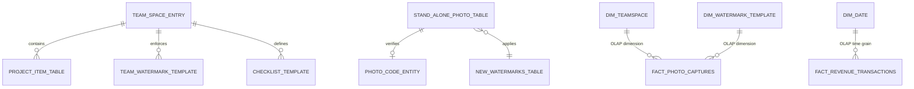

# Database Architecture — Relational OLTP (42 Tables) & OLAP Star Schema

> **Owner**: `Agent 1 - ARCHITECT` & `Agent 2 - BACKEND`  
> **Canonical Schema Contract**: [`Docs/Contracts/database-schema.md`](file:///E:/Decompiler/APP/IMAGE/Timemark/CONVERT/Docs/Contracts/database-schema.md)  
> **Related ADR**: [`ADR-003`](file:///E:/Decompiler/APP/IMAGE/Timemark/CONVERT/Docs/ADR/ADR-003-relational-and-olap-schema.md)

---

## 1. Dual-Plane Data Architecture (`VAN-HANH/Task.txt` #5)

To satisfy both 100% Android Room v61 client parity (`NextAICameraDB`, 42 tables) and enterprise BI analytics required by the Admin CMS, the database architecture is partitioned into two synchronized planes:

---

## 2. Plane 1: Relational OLTP Schema (42 Room v61 Parity Tables + Server SaaS Tables)

1. **Group A — Watermarks & Skins (8 Tables)**: `new_watermarks_table`, `cloud_water_mark_table`, `share_water_mark_table`, `cloud_category_table`, `use_recent_water_mark_table`, `recently_edited_table`, `watermark_template_edit_guide_table`, `history_grouping_table`.
2. **Group B — Photos, Attendance, Anti-Fake & Cloud Queue (7 Tables)**: `stand_alone_photo_table`, `picture_up_table`, `album_number_table_new`, `water_check_in_take_history_table`, `photo_code_entity`, `anti_code_entry`, `oss_data_table`.
3. **Group C — GPS, POI & Offline Geocoding Grid (5 Tables)**: `place_list_entity`, `search_place_entity`, `prefer_place_entity`, `custom_poi_table`, `lat_long_poi_entity`.
4. **Group D — Teamspace SaaS, Checklists & Patrol (8 Tables)**: `team_space_entry`, `team_watermark_template`, `upload_progress_task_entry`, `doc_upload_task_entry`, `checklist_template`, `checklist_submission`, `patrol_table`, `patrol_task_table`.
5. **Group E — WorkGroups & Batch Reports (10 Tables)**: `work_group_table`, `work_group_picture_table`, `work_group_water_mark_table`, `work_group_report_template_type_table`, `work_group_report_one_template_table`, `work_group_report_history_table`, `work_group_report_template_id_map_table`, `work_report_recommend_table`, `project_item_table`, `input_tab_table`.
6. **Group F — Notifications & Utilities (4 Tables)**: `notification_entity`, `home_notice_table`, `home_notice_new_table`, `baby_info_table`.

---

## 3. Plane 2: OLAP Analytical Star Schema (8 Fact & Dimension Tables)

| Table Name | Role | Primary Grain & Analytical Metrics |
|---|---|---|
| `dim_date` | Dimension | Calendar day, ISO week, month, quarter, construction shift |
| `dim_geography` | Dimension | Country, city, district, 500m geohash grid (`grid_key`) |
| `dim_teamspace` | Dimension | Team ID, plan tier (`FREE`, `PLUS`, `BUSINESS`), seat quota, storage quota |
| `dim_watermark_template` | Dimension | Template ID (`10011`, `57`, `34`, `52`), industry category, AI CV model |
| `fact_photo_captures` | Fact | Photo count, AI rebar count sum, NTP drift ms, GPS satellite count, anti-fake verification pass rate |
| `fact_attendance_events` | Fact | Check-in/out count, geofence compliance %, distance from site center (m), late/on-time ratio |
| `fact_revenue_transactions` | Fact | Gross bookings USD, net revenue, trial conversion rate, SKU breakdown, AdMob eCPM revenue |
| `fact_robotics_mcap_telemetry` | Fact | `.mcap` duration sec, hand-landmark confidence %, IMU sample rate Hz, BRL/MXN reward payout |
