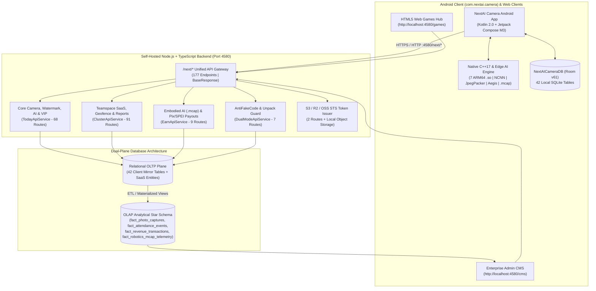

# Architecture Overview — NextAI Camera & Enterprise Field SaaS Platform

> **Package**: `com.nextai.camera`  
> **Version**: `10.0.281-nextai`  
> **Backend & CMS Port**: `http://localhost:4580`

---

## 1. End-to-End System Topology

---

## 2. Core Architectural Pillars

1. **Cryptographic Trust & Anti-Tamper Capture (`PreviewActivity` + `Aegis` + `JpegPacker`)**:
   - Every photo synchronizes atomic time via `/next/realtime` and locks GPS satellite coordinates (`lat`, `lng`, `azimuth`, `altitude`).
   - `AegisCaptureSession` signs the hardware frame buffer to reject virtual cameras and mock GPS injectors.
   - `JpegPacker` embeds the clean, unwatermarked bounding-box pixel slices (`SliceDataInfo[]`) and signed metadata after the JPEG `EOI` (`0xFFD9`) marker (`ACQ-20261026-002`).
2. **Offline-First Local Persistence (`NextAICameraDB` v61)**:
   - All 42 Room tables (`new_watermarks_table`, `stand_alone_photo_table`, `anti_code_entry`, `lat_long_poi_entity`, `team_space_entry`, etc.) cache watermarks, pre-allocated anti-fake codes, and 500m grid geocoding so construction workers can capture verified photos deep underground or offline.
3. **Edge AI Computer Vision (`libnextai_native.so`)**:
   - Runs on-device NCNN models for Rebar Counting (`SteelDetect` `#57`), License Plate Recognition (`VLPR` `#52`), Low-Light Enhancement (`ZeroDCE`), and `PaddleOCR` text verification.
4. **Enterprise Teamspace SaaS & 4-Pillar Monetization**:
   - Combines individual VIP (`NextAI Plus`), B2B Teamspace subscriptions, hybrid test-safe Ad Mediation, and Embodied AI `.mcap` robotics crowdsourcing (`NextAI Earn`).
